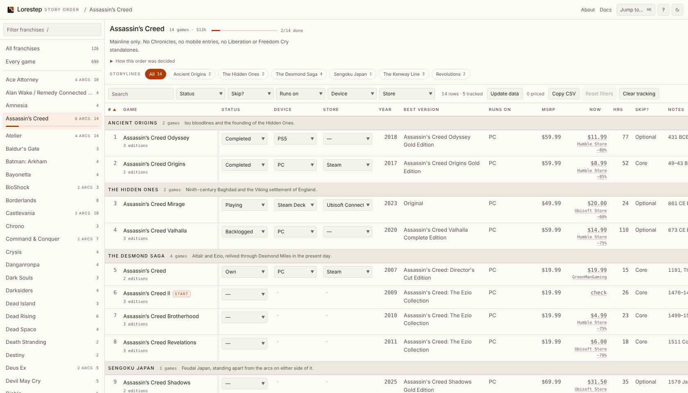
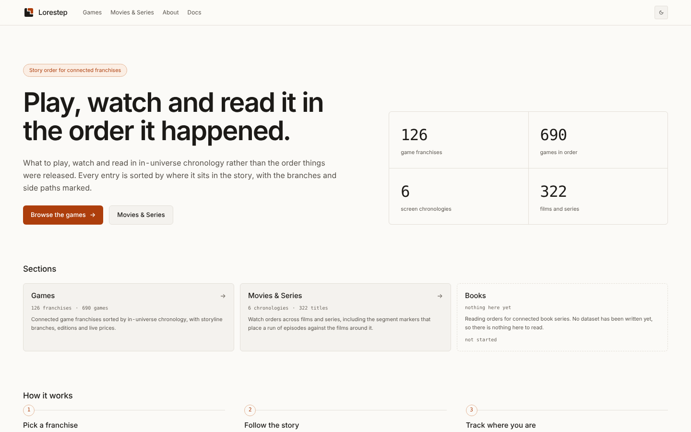
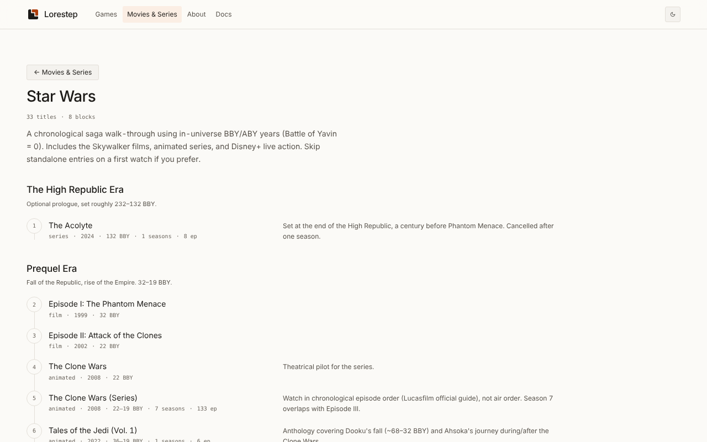

<p align="center"><picture><source media="(prefers-color-scheme: dark)" srcset="assets/lorestep-dark.svg"></picture></p>

<h1 align="center">Lorestep</h1>

<p align="center"><strong>Play, watch and read it in the order it happened.</strong><br>Connected franchises in story order, not release order. Free, no account.</p>

<p align="center">
  <a href="https://lorestep.akshitbansal.dev"><strong>Open Lorestep →</strong></a>
</p>

<p align="center">
  <a href="https://github.com/akshit-bansal11/lorestep/actions/workflows/ci.yml"></a>
  <a href="LICENSE"></a>
  <a href="https://lorestep.akshitbansal.dev"></a>
</p>

<picture>
  <source media="(prefers-color-scheme: dark)" srcset="assets/screenshots/table-dark.png">
  
</picture>

## Why

Release order and story order rarely agree. Assassin's Creed shipped in 2007, but its story starts with *Odyssey* in 431 BCE, eleven years and ten games later. Star Wars starts with *The Acolyte*, a century before *The Phantom Menace*. Working that out means reading wikis, forum threads and fan timelines that disagree with each other.

Lorestep does it once, per franchise: every entry sits where it falls in the story, with branches and side paths marked and a note on why each one is placed where it is.

## Features

- **Story order for 126 game franchises and 6 film and series chronologies**, with a written reason for every disputed placement.
- **Storylines split out.** Franchises that branch, such as Assassin's Creed, Zelda's timelines or Mega Man's eras, break into sections you can filter by.
- **Track your progress** per game: status, the device you play on and the store you own it from. It lives in your browser, with no account and no sign-up, and stays in sync across tabs.
- **Know what to buy.** Each game names the edition worth getting, marks the one to start with, flags what is optional or skippable, and shows current PC prices from [IsThereAnyDeal](https://isthereanydeal.com).
- **Keyboard first.** `Cmd/Ctrl K` jumps to any franchise or game; every view has a shareable URL (`/games#/witcher`, `/games#/ac/desmond`).
- **Light and dark themes**, usable at phone width, and checked against WCAG AA.

## What's covered

| Section | Route | Holds |
| --- | --- | --- |
| **Games** | [`/games`](https://lorestep.akshitbansal.dev/games) | 126 franchises, 690 games, 104 storylines |
| **Movies & Series** | [`/screen`](https://lorestep.akshitbansal.dev/screen) | 6 chronologies, 322 titles, 29 blocks: the MCU, Star Wars, the DCEU, the new DCU, Middle-earth, and Marvel on screen in full |
| **Books** | [`/books`](https://lorestep.akshitbansal.dev/books) | Nothing yet. No dataset has been written, and the section says so rather than showing invented titles |

<table>
  <tr>
    <td width="50%">
      <picture>
        <source media="(prefers-color-scheme: dark)" srcset="assets/screenshots/home-dark.png">
        
      </picture>
    </td>
    <td width="50%">
      <picture>
        <source media="(prefers-color-scheme: dark)" srcset="assets/screenshots/screen-dark.png">
        
      </picture>
    </td>
  </tr>
  <tr>
    <td align="center">The home page</td>
    <td align="center">A watch order: Star Wars</td>
  </tr>
</table>

## Keyboard shortcuts

| Key | Does |
| --- | --- |
| `Cmd/Ctrl K` | Jump to any franchise or game |
| `/` | Focus the franchise filter |
| `[` / `]` | Previous / next franchise |
| `G` | Back to the franchise grid |
| `Esc` | Close an overlay, or clear the filter |
| `?` | Show the shortcut list |

## Privacy

There is no account and no server-side user data. What you track is stored in your browser's `localStorage` and never leaves it. Clearing site data, or the **Clear tracking** button, removes it. Traffic is counted with Vercel Web Analytics, which sets no cookies.

## Something in the wrong place?

Story order gets argued over, and a source settles it. [Report a wrong or missing entry](https://github.com/akshit-bansal11/lorestep/issues/new?template=wrong-entry.yml) with one, or send the fix as a pull request; [CONTRIBUTING.md](CONTRIBUTING.md#changing-the-data) walks through the data format field by field. Bugs and ideas go through the [bug report](https://github.com/akshit-bansal11/lorestep/issues/new?template=bug-report.yml) and [feature request](https://github.com/akshit-bansal11/lorestep/issues/new?template=feature-request.yml) forms.

## Run it locally

You need Node 24 and a [Neon](https://neon.tech) Postgres database: the content pages read it when they render.

```sh
git clone https://github.com/akshit-bansal11/lorestep.git
cd lorestep
npm ci
cp .env.example .env.local   # set DATABASE_URL; ITAD_API_KEY is optional, for live prices
npm run data:seed            # create the tables and load the dataset
npm run dev                  # http://localhost:3001
```

`npm run check` runs the full gate (format, lint, types, data check, tests), the same one CI runs.

**Built with** Next.js 16, React 19, TypeScript, Tailwind CSS v4, Neon Postgres with Drizzle ORM, Vitest and Playwright, deployed on Vercel.

## Documentation

| Doc | Covers |
| --- | --- |
| [docs/DEVELOPMENT.md](docs/DEVELOPMENT.md) | Every script, the source layout, routes and rendering, the data model, deployment, observability, CI, motion and prices |
| [CONTRIBUTING.md](CONTRIBUTING.md) | Setting up a fork, the data format, and how a change gets reviewed |
| [CHANGELOG.md](CHANGELOG.md) | What changed in each release |
| [SECURITY.md](SECURITY.md) | Reporting a vulnerability privately |

## Credits

Prices and historical lows come from [IsThereAnyDeal](https://isthereanydeal.com). Release years, ratings and play times for the enriched franchises come from [IGDB](https://www.igdb.com). The film and series orders are merged from published watch-order guides, credited on the [About page](https://lorestep.akshitbansal.dev/about#sources).

## License

[MIT](LICENSE) © Akshit Bansal
